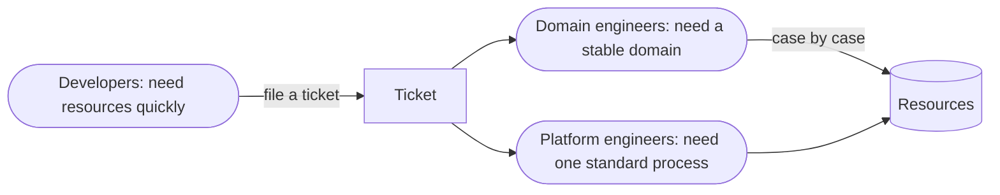
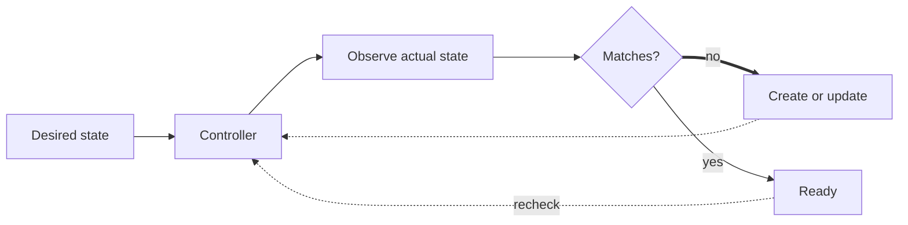
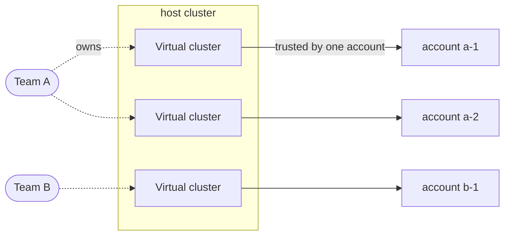
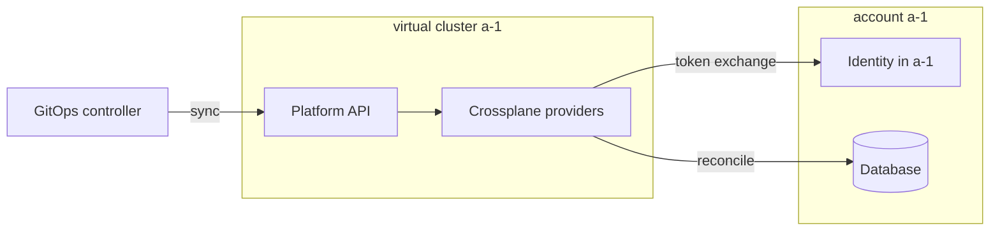
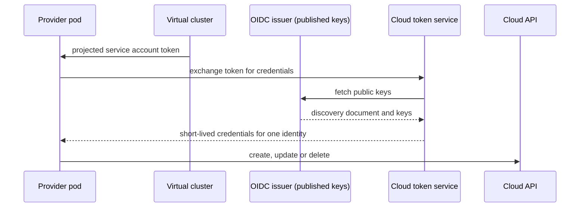
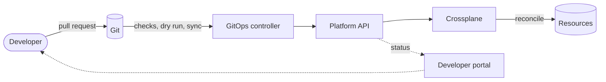
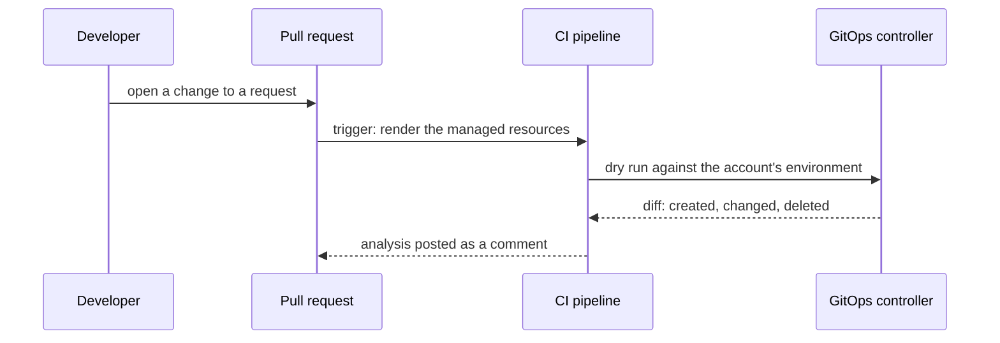
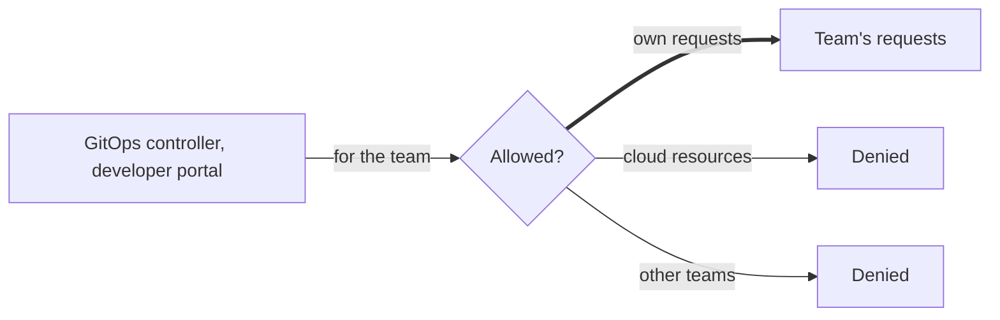

# A unified way to manage infrastructure

One API, domain-owned rules, and an isolated environment per account

<!--
This talk presents a design rather than a tool. The question it answers is how to provide cloud and on-prem resources to many teams in one consistent way, and keep them consistent over time.
The talk has four parts. First, the problem that appears when there is no standard way to provision and manage resources. Second, five design principles. Third, the two most important parts of the design: one API with domain-owned rules, and an isolated environment per account that authenticates to its cloud without stored credentials. Finally, the developer workflow and the costs of the design.
-->

---
layout: diagram
---

# Three roles with different needs

<!--
Three roles are usually involved. Developers need cloud and on-prem resources quickly. Domain engineers, the teams that own one type of infrastructure, need their domain to remain stable. Platform engineers need one standard process for provisioning resources and managing their lifecycle.
In many organisations, a ticket connects them. Developers file a ticket and wait. Domain engineers review it and build their part case by case. Platform engineers build the rest, each in their own way.
Each need is legitimate. The problem is that all three are served manually.
-->

---

# The cost of having no standard

- **Inefficient**: requests wait days for manual checks and approvals.
- **Error-prone**: safety depends on the requester knowing every side effect of a change.
- **Fragmented**: requests move back and forth between teams.
- **Inconsistent**: each engineer handles requests differently, so resources diverge over time.

<!--
The first three problems come from the ticket process. The fourth is its long-term effect.
Engineers use different machines, tool versions, copies of shared code and working habits. Unless a standard requires otherwise, two identical requests handled by two engineers produce two slightly different resources. Over time, nobody can state exactly what is running, and a fix reaches only the resources that someone happens to change again.
This is not a tooling problem. Shared infrastructure code, such as reusable modules, does not prevent it on its own. Without an enforced standard, divergence is the default outcome.
-->

---
layout: statement
---

# The goal is not a better tool. It is one consistent way to manage every resource.

<!--
Replacing one tool with another moves the problem, but does not solve it. The goal is one way to provision a resource and one way to manage its full lifecycle, applied to every team and every type of resource.
-->

---

# Five design principles

- **One API**: every resource is requested as a Kubernetes object.
- **Domain ownership**: each domain team defines how its resources are built.
- **Platform-owned lifecycle**: the platform keeps every resource aligned with its definition.
- **Isolation by default**: each account has its own control plane and identity.
- **Validation before change**: every request is checked before it is merged.

<!--
The rest of the talk applies these five principles.
One API: a database, a network and a monitoring alert are requested in the same format, through the same API, with the same access control.
Domain ownership: the team that owns a type of infrastructure defines how it is built. The platform applies those rules but does not define them.
Platform-owned lifecycle: a request is not complete when the resource is created. The platform keeps the resource aligned with its definition for as long as it exists.
Isolation by default: a failure in one account stays in that account, and no environment holds a long-lived cloud key.
Validation before change: developers see the effect of a change while it is still a pull request.
-->

---
layout: section
---

# One API with domain ownership

Principles one to three

---

# Kubernetes already provides a resource API

- Each object records a desired state.
- Controllers compare the desired state with the actual state and correct any difference.
- The API server provides access control, validation and auditing.
- The API server handles object creation, updates, deletion and status.
- Crossplane applies the same model to cloud and on-prem resources.

<!--
In this design, Kubernetes is used as an API server and a reconciliation engine, not as a container platform.
The principles in this section require three things: an API with access control, a lifecycle engine, and an extension point for many domains. Kubernetes provides the first two. Crossplane provides the third, using the same controller model as the rest of Kubernetes.
-->

---
layout: diagram
---

# Continuous reconciliation

<!--
This loop is how the platform owns the lifecycle. It runs continuously. If someone changes a resource manually in the cloud, the next pass detects the difference and the controller restores the defined state.
Because the desired state is an API object, every intended change is recorded by the API server. This provides the audit trail.
-->

---

# How Kubernetes and Crossplane meet the principles

| Principle | Capability |
| --- | --- |
| **One API** | the Kubernetes API server, with access control, validation and auditing |
| **Domain ownership** | compositions and providers, maintained by each domain team |
| **Platform-owned lifecycle** | a reconciliation loop per resource that also reverts manual changes |
| **Isolation by default** | one control plane per account, with workload identity for credentials |
| **Validation before change** | admission checks and server-side dry run |

<!--
Each principle maps to a capability that already exists.
If asked about alternatives: cloud vendor operators provide one API per cloud and do not cover on-prem systems. Building custom controllers makes the platform team responsible for every integration. Running Terraform inside a controller keeps existing code, but also keeps per-workspace plans and state files, and does not provide a platform API.
The main cost is operating a control plane. The final slide returns to this.
-->

---

# Crossplane separates the API from its implementation

| Component | Owner | Purpose |
| --- | --- | --- |
| XRD | domain engineers | defines the API developers use, for example a `Database` with a size |
| Composition | domain engineers | defines how a request becomes resources, including the domain's rules |
| Provider | domain engineers | calls the domain's API and reports status |
| Request | developers | states what is needed, for example one database |

<!--
This separation enables domain ownership. Domain engineers own three of the four components. Developers write only the request.
The platform team owns none of these components. It owns the guidelines they follow, the control plane they run on, and the surrounding integrations.
A change to a composition, such as a new default or a required tag, is made once and applies to every resource built from it.
-->

---

# Extending the platform to any domain

- **Convert**: generate a Crossplane provider from an existing Terraform provider.
- **Build**: implement observe, create, update and delete against the domain's API.
- **Scope**: SaaS services, internal systems and on-prem infrastructure can all join the same API.

<!--
A provider is a set of controllers, one per resource type. Each controller runs the reconciliation loop against the domain's API.
There are two ways to create one. If the domain has a Terraform provider, the upstream generator converts it, so existing work is reused. Otherwise, the domain team builds a custom provider. It implements four operations per resource type, and the Crossplane runtime provides the loop, retries, status reporting and events.
This allows systems outside the public clouds, such as an incident management service or an internal address management system, to use the same API as the cloud providers.
-->

---

# API design guidelines

- **Naming**: one convention identifies each resource's owner and location.
- **Stable external names**: retries and re-creations target the same resource instead of creating duplicates.
- **Early validation**: CEL rules reject invalid requests immediately, with actionable messages.
- **Mandatory tags**: every resource carries owner and cost tags, set by the composition.

<!--
Domain engineers design their own APIs, so every API must follow a common set of rules. Without them, each domain develops its own conventions.
Stable external names: if a resource's cloud name is generated, a retry after a timeout can create a duplicate and leave the original without an owner.
Early validation: without CEL rules, an invalid value is rejected only when the provider calls the cloud, several minutes later, with an error that is hard for the developer to interpret.
Mandatory tags make ownership and cost visible in the developer portal.
-->

---
layout: section
---

# Isolation by default

One control plane and one identity per account

---

# Risks of a shared control plane

- **Blast radius**: a single error affects every team.
- **Credential exposure**: one environment with access to every account is a high-value target.
- **Unclear ownership**: it is difficult to determine who owns a resource and who may delete it.
- Therefore, each account is connected to its own isolated environment.

<!--
As self-service makes requests easier, the number of resources grows, and these risks become routine concerns.
Teams bring their own subscriptions or accounts, and a team may bring several, depending on the cloud environments it needs. The rule is one isolated environment per account, not per team.
-->

---
layout: diagram
---

# One virtual cluster per account

<!--
Each account has its own virtual cluster inside a shared host cluster. A virtual cluster is a complete Kubernetes API server with its own objects, permissions and service accounts, but it runs as a small set of pods on the host. This makes one cluster per account affordable.
In this example, one team has two accounts and therefore two virtual clusters. The other team has one.
The platform team creates every virtual cluster from one definition and upgrades them together, so multiple control planes do not reintroduce divergence. Adding an account means adding one virtual cluster from the same definition.
-->

---
layout: diagram
---

# Inside a virtual cluster

<!--
Each virtual cluster runs its own Crossplane providers. They can create resources in only one account, because they can obtain credentials only for that account.
These credentials are never stored. The provider exchanges its service account token for short-lived cloud credentials, as shown on the next slide.
-->

---
layout: diagram
---

# Workload identity: no stored credentials

<!--
This is OIDC federation between Kubernetes and the cloud, commonly called workload identity. All major cloud providers support it.
The provider pod runs as a Kubernetes service account. Kubernetes mounts a short-lived token for it, signed by the service account issuer, with the cloud as the audience.
The provider sends the token to the cloud's token service. The cloud does not contact the cluster. It retrieves the issuer's discovery document and public keys from the published issuer URL, verifies the signature, subject and audience, and returns credentials for one identity that expire within an hour.
No cloud key is stored in the cluster, in Git or in a secret. A leaked token is valid for at most one hour, for one identity, in one account.
The combination of issuer and subject is unique to one environment. Either each virtual cluster is its own issuer and the subject is the provider's service account, or the host cluster is the issuer and the subject identifies the environment. In both cases, a token from another environment does not match the trust policy on the next slide.
-->

---

# Each account trusts exactly one environment

| Element | Configured in the account | Effect |
| --- | --- | --- |
| Issuer | the environment's OIDC issuer URL | only tokens signed by this environment are accepted |
| Audience | the cloud's token service | only tokens intended for this cloud are accepted |
| Subject | the provider's service account | only the provider in this environment is accepted |
| Identity | one role or managed identity | the provider receives only that identity's permissions |

<!--
The trust is configured on the cloud side, in the account that owns the resources. It names one issuer, one audience and one subject. Tokens from any other environment do not match, so no other environment can obtain credentials, even if it is misconfigured.
Each cloud names these pieces differently. On AWS, it is an IAM OIDC identity provider and a role trust policy. On Azure, it is a federated credential on a managed identity. On Google Cloud, it is a workload identity pool provider and a service account binding.
In Crossplane, the provider configuration uses the projected token as its credential source instead of a secret.
On-prem systems that accept OIDC tokens can use the same pattern. Systems that do not, such as some SaaS APIs, still require a token. That token is stored only in the environment that needs it.
-->

---

# Benefits and costs of isolation

- **Benefit**: failures, leaked tokens and faulty upgrades are contained within one account.
- **Benefit**: there are no long-lived cloud keys to store, rotate or protect.
- **Cost**: each account requires a control plane to operate, monitor and upgrade.
- **Cost**: each issuer's discovery document and keys must be reachable by the cloud provider.

<!--
The operational cost of many control planes is significant. This is why every virtual cluster is created from one definition and upgraded together. Without that, divergence would return, this time between control planes.
The issuer requirement is often overlooked. The cloud's token service must be able to retrieve the issuer's discovery document and keys over HTTPS. For a private cluster, this usually means publishing them to a public bucket or endpoint.
-->

---
layout: section
---

# Validation before change

Developers work through Git and the developer portal

---
layout: diagram
---

# From pull request to provisioned resource

<!--
Developers define the resources they need as standard Kubernetes objects and open a pull request. They do not need cluster access.
Before the merge, checks and a dry run report the effect of the change. After the merge, a GitOps controller operated by the platform team, such as Argo CD or Flux, syncs the request into the account's virtual cluster, and Crossplane provisions the resources.
Status is published to the developer portal, which developers already use daily. Git and the portal are the only two interfaces developers need.
-->

---
layout: diagram
---

# Pull request checks

<!--
Each pull request triggers a CI pipeline. The pipeline renders the managed resources the request would produce, in the same way Crossplane would. It then runs a dry run through the GitOps controller against that account's environment, so the comparison is made against the running state, not only the last commit.
The pipeline posts the result as a comment on the pull request: what would be created, changed or deleted, and anything that would be rejected. Developers and reviewers see the effect of the change before it is merged.
This replaces the manual review step of the ticket process and completes in minutes.
-->

---

# Developer portal

Each team has a single page that shows:

- **Ownership**: the team's services and their underlying resources.
- **Status**: whether each resource is ready, and if not, the reason.
- **Cost**: the current cost and the estimated cost of new requests, based on tags.

<!--
The page is organised by team rather than by request. It reads from each of the team's virtual clusters, so the portal must know which environments belong to which team. The same mapping, from user to team to environments, also determines permissions.
Status is derived from Crossplane conditions and presented in plain language. Instead of "Synced=False, reason ReconcileError", the page shows "waiting for a network that is not ready yet".
Cost is calculated from the owner and cost tags that every composition sets.
-->

---
layout: diagram
---

# Scoped permissions

<!--
This completes the isolation model. The GitOps controller and the developer portal act on behalf of the team with one narrow permission: create, read, update and delete requests in the team's own virtual clusters. The managed resources created by Crossplane are not accessible, and other teams' requests reside in other virtual clusters.
Developers do not need direct cluster access.
-->

---

# Costs of the design

- **Control planes**: one per account, operated and upgraded by the platform team.
- **Provider maintenance**: each domain team maintains its own providers.
- **Guideline governance**: every new API must follow the naming, validation and tagging rules.
- **Onboarding**: domain engineers must learn to write compositions and providers.

<!--
Each cost corresponds to a principle. Control planes per account are the cost of isolation. Domain-maintained providers are the cost of domain ownership. Guideline governance is the cost of one API across many domains.
In return, adding a team, an account or a resource type is a configuration change rather than additional manual work. This is what allows the platform to scale.
-->

---
layout: end
---

# exit

Thank you. Questions?
