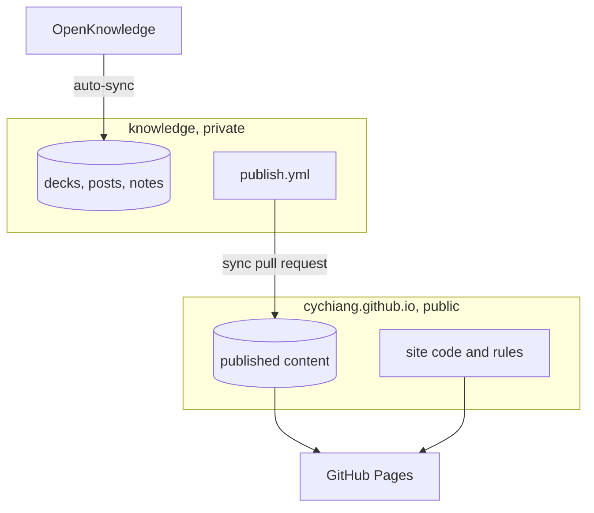
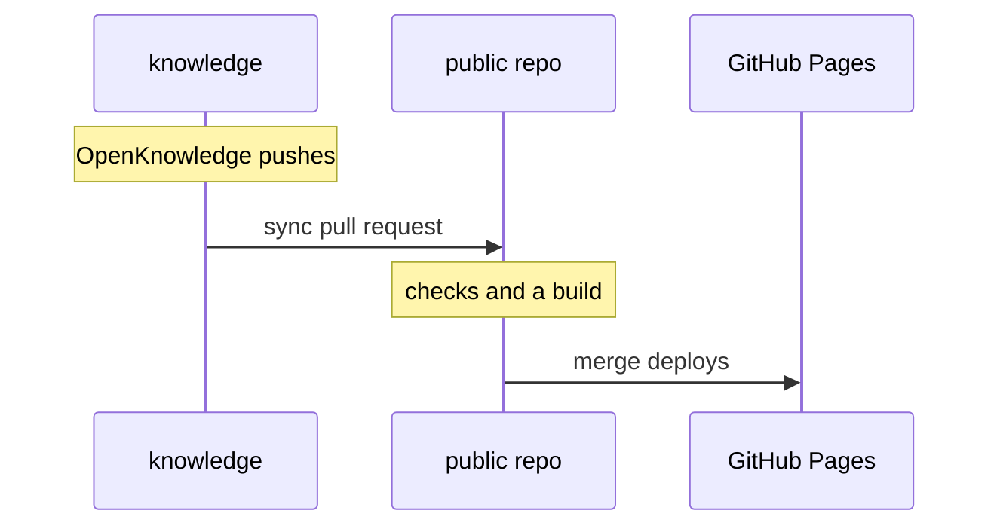

Everything on this site starts as a Markdown file in a private Git
repository. A list in that repository decides what is public, and an
automated pull request publishes it.

## Knowledge as code

Decks, posts, the about page, drafts and working notes are plain Markdown
files under version control. I write them in OpenKnowledge, which commits
and pushes every change. Like code, every change has a history, can be
reviewed, and is checked before it ships.

## Private and public, managed separately

- **knowledge** (private) holds everything I write.
- **publish.yml** lists the items that are public. Anything not listed,
  and any note next to a deck, stays private.
- **cychiang.github.io** (public) holds the site code, the design system,
  the checks and the published content only.

Content is private by default. Publishing is a line in one file, not a
file that has to be kept out of a public repository.

## Automated publishing

1. A push that changes published content starts a GitHub Action in the
   private repository.
2. The action copies exactly the listed items into the public repository
   and opens a pull request.
3. The public repository checks the frontmatter and links and builds the
   whole site.
4. Merging the pull request deploys the site to GitHub Pages.

The one manual step is the merge, so nothing is published without a last
look.
